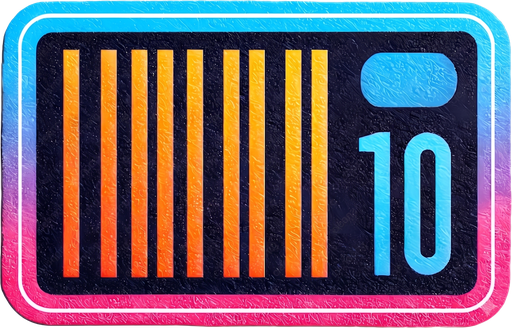
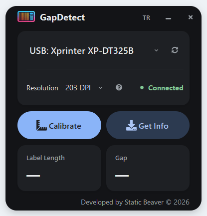

<div align="center">



# GapDetect

**One-click calibration & label/gap measurement for TSPL label printers on Windows.**

Works with Xprinter, TSC, Gprinter and other TSPL-compatible thermal label printers over USB or Serial (COM) — no extra drivers, no libusb.

[](https://github.com/StaticBeaver/gapdetect/releases/latest)
[](LICENSE)


</div>

<p align="center"></p>

## Why?

Label printers often lose track of where one label ends and the next begins — you get labels printed across the gap, skipped labels, or a blinking error light. The fix is a **gap calibration**, but many cheap printers ship with clunky (or no) tools to do it, and the Windows print spooler makes reading data back from the printer painful.

GapDetect does it in one click and also reads back the label length and gap size the printer has detected, in millimeters.

## Features

- **One-click calibration** — sends the TSPL `GAPDETECT` command so the printer learns your label/gap layout.
- **Read current settings** — fetches `ALLCONFIG` from the printer and shows label length and gap size in mm.
- **Direct USB (RAW) access** — talks to the printer through Windows' built-in USB Printer Class driver, completely bypassing the print spooler. Your existing printer queue stays untouched.
- **Serial (COM) support** for printers connected over RS-232 / virtual COM ports.
- **DPI aware** — 203 / 300 / 600 DPI for correct dot → mm conversion.
- **Remembers** your last printer, DPI and language.
- **Light / dark mode** follows your Windows theme.
- **Clean, distraction-free English UI** with modern frameless design.

## Download

Grab the latest `GapDetect.exe` from the **[Releases page](https://github.com/StaticBeaver/gapdetect/releases/latest)** — no installation needed, just run it.

> Windows SmartScreen may warn about an unknown publisher because the executable isn't code-signed. Click **More info → Run anyway**, or build it yourself from source (below).

## Usage

1. Plug in your printer and load labels.
2. Open GapDetect and select your printer from the list (it connects automatically).
3. Choose your printer's DPI (most budget label printers are **203 DPI**).
4. Click **Calibrate** — the printer feeds a few labels to detect the gap.
5. Click **Get Info** to read back the detected label length and gap.

## Run from source

Requirements: Windows, Python 3.8+

```bash
git clone https://github.com/StaticBeaver/gapdetect.git
cd gapdetect
pip install -r requirements.txt
python main.py
```

### Build the .exe

```bash
pip install pyinstaller
pyinstaller GapDetect.spec
```

The executable will be created in `dist/GapDetect.exe`.

## For developers: raw USB printing on Windows without libusb

[`usbprint_raw.py`](usbprint_raw.py) is a small, dependency-free module you can reuse in your own projects. It shows how to:

- enumerate `GUID_DEVINTERFACE_USBPRINT` devices with `setupapi.dll`,
- open them with `CreateFile` and do **asynchronous (OVERLAPPED)** `ReadFile` / `WriteFile` via `ctypes`,
- avoid deadlocks on unresponsive printers with timeouts and `CancelIoEx`.

```python
from usbprint_raw import list_usbprint_devices_with_names, RawUsbPrinter

path, name = list_usbprint_devices_with_names()[0]
with RawUsbPrinter(path) as printer:
    printer.write(b"ALLCONFIG\r\n")
    data, err = printer.read(1024, timeout=2.5)
    print(name, data.decode(errors="ignore"))
```

No PyUSB, no libusb, no Zadig driver swapping — it uses the driver Windows already installed for your printer.

## Supported printers

Any printer that speaks **TSPL / TSPL2** should work. Tested with Xprinter label printers. If you've tried it with another model, please open an issue or PR to add it to this list!

## Contributing

Bug reports, printer compatibility reports and pull requests are welcome. Please open an [issue](https://github.com/StaticBeaver/gapdetect/issues) first for larger changes.

## License

[MIT](LICENSE) © 2026 StaticBeaver
